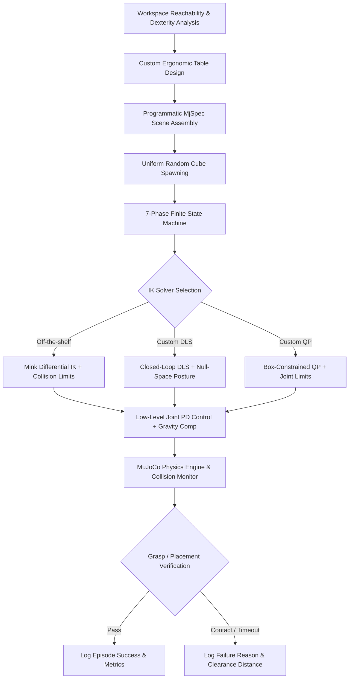

# Lab 03 — Autonomous Pick-and-Place Manipulation with HEAL & Franka Emika Panda

A robust, physics-accurate pick-and-place manipulation pipeline in [MuJoCo](https://mujoco.org/) comparing **Differential Inverse Kinematics (IK)** solvers across both 6-DOF and 7-DOF redundant robotic arms equipped with a Robotiq 2F-85 parallel-jaw gripper.

🎥 **Video Demonstration:**
- **Franka Panda DLS Failure Mode Analysis:** [Watch on YouTube](https://youtu.be/ERtZ837I5WE) — Demonstrates redundant null-space elbow swivel and follower linkage tray-wall grazing during the `RELEASE` phase.

---

## Table of Contents

1. [Overview & Key Features](#overview--key-features)
2. [Workspace Analysis & Table Design](#workspace-analysis--table-design)
3. [Environment Modeling & Programmatic Assembly](#environment-modeling--programmatic-assembly)
4. [7-Phase Pick-and-Place State Machine](#7-phase-pick-and-place-state-machine)
5. [Inverse Kinematics Formulations](#inverse-kinematics-formulations)
   - [Off-the-Shelf Differential IK (Mink)](#1-off-the-shelf-differential-ik-mink)
   - [Closed-Loop Damped Least Squares (DLS)](#2-closed-loop-damped-least-squares-dls-with-null-space-projection)
   - [Constrained Quadratic Programming (QP)](#3-constrained-quadratic-programming-qp)
6. [Experimental Results & Benchmarking](#experimental-results--benchmarking)
   - [HEAL 6-DOF Benchmark (250 Episodes, Seed 19)](#heal-6-dof-benchmark-250-episodes-seed-19)
   - [Franka Emika Panda 7-DOF Benchmark (30 Episodes, Seed 19)](#franka-emika-panda-7-dof-benchmark-30-episodes-seed-19)
7. [Failure Mode & Collision Analysis](#failure-mode--collision-analysis)
   - [Robotiq Follower Linkage Table Scraping (Resolved)](#1-robotiq-follower-linkage-table-scraping-resolved)
   - [Franka Redundant Null-Space Tray Wall Grazing (YouTube Demo)](#2-franka-redundant-null-space-tray-wall-grazing-youtube-demo)
8. [Quickstart & Execution Guide](#quickstart--execution-guide)
9. [Codebase Architecture & File Inventory](#codebase-architecture--file-inventory)

---

## Overview & Key Features

This lab implements an end-to-end autonomous manipulation pipeline that solves randomized pick-and-place tasks:
- **Robots Evaluated:**
  - **HEAL 6-DOF Arm:** Anthropomorphic industrial manipulator (`single_arm_heal_effort_actuation_rs_mj.xml`).
  - **Franka Emika Panda 7-DOF Arm:** Redundant collaborative robot (`panda_nohand.xml`).
- **End-Effector:** Robotiq 2F-85 adaptive parallel-jaw gripper dynamically attached at runtime using MuJoCo's programmatic `MjSpec` API.
- **IK Solvers Compared:**
  1. **Mink** (Differential IK via OSQP with quadratic task costs and collision avoidance inequality constraints).
  2. **DLS** (Closed-loop Damped Least Squares with pseudoinverse damping and posture-optimizing null-space projection).
  3. **QP** (Box-constrained Quadratic Program mapping joint velocity bounds, position limits, and regularized positive-definite Hessian).
- **Safety & Physics:** Continuous signed clearance distance queries (`mj_geomDistance`), gravity compensation feedforward (`qfrc_bias`), and dual-pad grasp force verification.



---

## Workspace Analysis & Table Design

Standard robotic tables (e.g., the default 1.2 m × 1.2 m, 0.80 m robosuite table) severely constrain manipulators by placing targets near reachability boundaries and causing collisions with the robot base turret. 

To determine the mathematically optimal table dimensions, reachable task workspace (gripper pointing vertically downward) and dexterous workspace (arbitrary yaw rotation) were computed via Monte Carlo discretization in `scripts/workspace_task.py` and `table_design.py`.


### Quantitative Table Specifications

| Parameter | Optimized Value | Engineering Rationale |
|---|---|---|
| **Surface Height** | **0.20 m** | Downward TCP grasps sit near **$z = 0.36\text{ m}$**, directly inside the maximum manipulability core of `heal_workspace_xz.png`. |
| **Footprint ($X \times Y$)** | **0.34 m × 0.60 m** | Fitted strictly to dexterous cells in front of the base ($x \in [0.24, 0.58]$, $y \in [-0.30, 0.30]$), with a 3 cm safety inset from the reachability rim. |
| **Table Center Placement** | **$(0.41, 0.00)\text{ m}$** | Located in the $+X$ primary task sector with a 0.18 m keep-out radius around the base to prevent turret collision. |
| **Top Thickness** | **0.04 m** | Lightweight surface with support legs extending to the floor ($z = 0.00\text{ m}$). |


### Approach & Clearance Envelope
- The Robotiq 2F-85 gripper measures approximately **0.16 m** from mounting flange to fingertip pad center. With the table surface at $0.20\text{ m}$, a top-down grasp places the end-effector site at $z \approx 0.36\text{ m}$.
- The vertical transit band **$z \in [0.26, 0.56]\text{ m}$** lies well within the high-dexterity sphere (maximum arm reach $z \approx 1.07\text{ m}$, manipulability degrades significantly above $z \approx 0.80\text{ m}$).
- Lower tables ($0.08 - 0.12\text{ m}$) squeeze the gripper linkage against the surface during pre-grasp. Higher tables ($0.36 - 0.44\text{ m}$) dramatically shrink the dexterous area and push grasps toward kinematic singularity limits.

To regenerate table metrics and the XML definition:
```bash
cd lab/lab-03
source ../../venv/bin/activate
python3 table_design.py
```

---

## Environment Modeling & Programmatic Assembly

The simulation scene is assembled programmatically at runtime using MuJoCo's modern `MjSpec` API (`scripts/env_pick_place.py` for HEAL and `scripts_franka/env_pick_place.py` for Franka).

| Component | Model & Parameters | Role & Mechanics |
|---|---|---|
| **Robot Manipulator** | 6-DOF HEAL (`single_arm_heal_effort_actuation_rs_mj.xml`) or 7-DOF Franka Panda (`panda_nohand.xml`) | Torque-actuated revolute joints controlled via low-level joint PD loops with gravity compensation feedforward (`qfrc_bias`). |
| **End-Effector** | Robotiq 2F-85 Gripper | Programmatically attached to the arm's terminal site (`right_center` for HEAL, `attachment_site` for Franka) via `MjSpec.attach()`. |
| **Worksurface** | Optimized custom table (0.34 m × 0.60 m × 0.04 m at $z = 0.20\text{ m}$) | Serves as the stable support plane for pick-and-place operations. |
| **Target Object** | 5 cm cubic block ($0.05\text{ m}$, 80 g, freejoint, red) | Spawned at a uniformly sampled position on the $+Y$ half of the table: $x \in [0.30, 0.50]$, $y \in [0.06, 0.22]$, with randomized initial yaw $\psi \in [-\pi, \pi]$. |
| **Receptacle Tray** | 12 cm × 12 cm green tray with 1.5 cm raised perimeter walls | Centered on the $-Y$ table sector at $(0.41, -0.12)\text{ m}$. Raised walls prevent the placed block from sliding off. |

---

## 7-Phase Pick-and-Place State Machine

The task supervisor executes a deterministic 7-phase state machine. Each phase regulates end-effector Cartesian waypoints, orientation quaternions, and gripper actuator commands:

```
  [APPROACH] ──> [DESCEND] ──> [GRASP] ──> [LIFT] ──> [TRANSIT] ──> [LOWER] ──> [RELEASE] ──> [DONE]
```

1. **`APPROACH` (Pre-Grasp Waypoint):**
   - End-effector aligns directly above the randomized cube position at $z_{approach} = z_{table} + 0.12\text{ m} + \Delta z_{ee}$.
   - End-effector orientation is aligned with the top-down normal vector combined with the cube's randomized yaw.
2. **`DESCEND` (Vertical Grasp Alignment):**
   - Gripper descends vertically along the Z-axis to the calibrated grasp height ($z_{grasp} = z_{table} + 0.035\text{ m} + \Delta z_{ee}$).
3. **`GRASP` (Fingertip Closure):**
   - Gripper actuator closes the 2F-85 fingers until simultaneous normal contact forces are established on opposing cube faces ($F_{pad} > 0.5\text{ N}$) or closure completes without jamming.
4. **`LIFT` (Vertical Object Retraction):**
   - The arm ascends vertically to $z_{lift} = z_{table} + 0.15\text{ m} + \Delta z_{ee}$, lifting the cube cleanly off the table surface without tipping or slippage.
5. **`TRANSIT` (Horizontal Tray Transfer):**
   - End-effector transfers the grasped block laterally across the workspace to a target waypoint positioned directly above the receptacle tray at $(0.41, -0.12, z_{lift})$.
6. **`LOWER` (Receptacle Placement):**
   - The arm lowers the block into the receptacle tray to $z_{place} = z_{table} + 0.035\text{ m} + \Delta z_{ee}$.
7. **`RELEASE` (Detachment & Upward Retreat):**
   - The gripper actuator commands full finger opening. Once the block detaches cleanly onto the tray floor, the arm retreats upward to safe clearance height $z_{lift}$.

### Collision Avoidance & Continuous Distance Monitoring
Every simulation timestep queries narrow-phase distances using `mujoco.mj_geomDistance`:
- Evaluates signed clearances between robot links/gripper linkages and static furniture (`table`, `tray_base`, `tray_walls`).
- Disallowed contacts (e.g., gripper base scraping the table or arm links striking tray boundaries) immediately trigger episode failure and are logged with the exact interacting geometry IDs and negative distance margins.

---

## Inverse Kinematics Formulations

To evaluate controller performance, three distinct mathematical formulations of differential inverse kinematics were implemented:

### 1. Off-the-Shelf Differential IK (Mink)
[Mink](https://github.com/kevinzakka/mink) formulates IK as a quadratic optimization program solved at each step:
$$\min_{\Delta q} \frac{1}{2} \| J(q) \Delta q - e_x \|_W^2 + \frac{1}{2} \| \Delta q \|_{R}^2$$
$$\text{subject to } \Delta q_{min} \le \Delta q \le \Delta q_{max}, \quad C \Delta q \le d$$
- Enforces joint velocity limits, joint angle limits, and smooth Cartesian error damping.
- Includes `mink.CollisionAvoidanceLimit` between robot collision geometries and obstacle geometries via linear distance inequalities.

### 2. Closed-Loop Damped Least Squares (DLS) with Null-Space Projection
DLS resolves kinematic singularities by damping the pseudoinverse of the end-effector Jacobian $J \in \mathbb{R}^{6 \times n}$:
$$J^\dagger = J^T \left( J J^T + \lambda^2 I_6 \right)^{-1}$$
where $\lambda = 0.05$ is the damping coefficient.

The task-space tracking error vector $e \in \mathbb{R}^6$ combines Cartesian position error and orientation error via quaternion vector-part dynamics:
$$e = \begin{bmatrix} K_p (x_{target} - x_{ee}) \\ K_o \text{ori\_error}(R_{target}, R_{ee}) \end{bmatrix}$$

#### Redundancy Resolution (7-DOF Franka Panda)
For the 7-DOF Franka arm ($n = 7$), the $6 \times 7$ Jacobian possesses a 1-dimensional null space. To prevent unconstrained elbow drift, an explicit null-space projector is integrated:
$$P_{null} = I_n - J^\dagger J$$
$$\dot{q}_{cmd} = J^\dagger e + P_{null} \cdot k_{null} (q_{default} - q)$$
where:
- $q_{default} = [0, 0, 0, -1.5708, 0, 1.5708, -0.7853]^T$ defines the natural upright arm posture.
- $k_{null} = 1.0\text{ s}^{-1}$ pulls redundant joints toward posture rest without perturbing end-effector tracking.
- Joint velocities are strictly clamped to physical actuator limits ($[-2.0, 2.0]\text{ rad/s}$).

### 3. Constrained Quadratic Programming (QP)
Formulates instantaneous velocity resolution as a convex quadratic program solved via `scipy.optimize.linprog` or OSQP:
$$\min_{\dot{q}} \frac{1}{2} \dot{q}^T P \dot{q} + c^T \dot{q}$$
$$\text{subject to } \dot{q}_{min} \le \dot{q} \le \dot{q}_{max}$$

- **Objective Construction:**
  $$P = J^T J + \lambda^2 I_n, \quad c = -J^T K_p e$$
  For the redundant 7-DOF Franka arm, $J^T J$ is rank-deficient ($\text{rank} \le 6$). Adding the regularization diagonal term $\lambda^2 I_7$ ($\lambda = 10^{-2}$) ensures $P$ is strictly positive definite and convex.
- **Dynamic Joint Velocity Bounds:**
  $$\dot{q}_{max, i} = \min\left(v_{limit, i}, \, \frac{q_{max, i} - q_i}{\Delta t}\right), \quad \dot{q}_{min, i} = \max\left(-v_{limit, i}, \, \frac{q_{min, i} - q_i}{\Delta t}\right)$$
  ensuring joints naturally decelerate before reaching mechanical limits.

---

## Experimental Results & Benchmarking

Comprehensive overnight batch benchmarks were executed across both robotic platforms using a deterministic global seed (`--seed 19`) to evaluate success rates, solver computational latency, iteration counts, and minimum obstacle clearance margins.

### HEAL 6-DOF Benchmark (250 Episodes, Seed 19)

All three solvers achieved a **100.0% success rate** across 250 randomly spawned pick-and-place episodes.

| Metric | Mink (Off-the-shelf) | DLS (Closed-loop) | QP (Constrained) |
|---|:---:|:---:|:---:|
| **Success Rate** | **100.0%** (250/250) | **100.0%** (250/250) | **100.0%** (250/250) |
| **Mean Planning Time per Episode** | 0.753 s | **0.299 s** (⚡ 2.5× faster) | 0.585 s (⚡ 1.3× faster) |
| **Mean Wall-Clock Time per Episode** | 9.15 s | **8.51 s** | 9.15 s |
| **Median IK Iterations** | 2,893 | 2,895 | 2,895 |
| **Total Solver Iterations** | 713,155 | 713,306 | 713,302 |
| **Minimum Clearance Margin** | 1.39 mm | 1.57 mm | 1.57 mm |


#### Key Takeaways (HEAL 6-DOF):
1. **Computational Efficiency:** The analytical closed-loop DLS formulation runs **2.5× faster** than Mink (0.299 s vs 0.753 s per episode), as it computes the pseudoinverse directly without setting up an iterative optimization problem.
2. **Path Convergence:** All three solvers produced virtually identical iteration counts (~2,895 steps), indicating that well-tuned proportional tracking gains achieve the same trajectory fidelity as constrained optimization when joints remain safely away from limits.
3. **Clearance:** All solvers maintained a safe positive clearance margin (> 1.38 mm) away from all furniture surfaces.

---

### Franka Emika Panda 7-DOF Benchmark (30 Episodes, Seed 19)

The redundant 7-DOF kinematic chain introduces an additional degree of freedom, requiring active null-space stabilization.

| Metric | Mink (Off-the-shelf) | DLS (Null-space projected) | QP (Regularized) |
|---|:---:|:---:|:---:|
| **Success Rate** | **100.0%** (30/30) | **93.3%** (28/30) | **96.7%** (29/30) |
| **Mean Planning Time per Episode** | 1.229 s | **1.166 s** | 1.275 s |
| **Mean Wall-Clock Time per Episode** | 206.59 s | 272.77 s | 246.17 s |
| **Total Solver Iterations** | 145,620 | 143,745 | 140,824 |
| **Mean Iterations per Episode** | 4,854 | 4,889 | 4,856 |
| **Minimum Obstacle Clearance** | **+1.58 mm** | **-0.031 mm** (grazing) | **-0.025 mm** |


---

## Failure Mode & Collision Analysis

### 1. Robotiq Follower Linkage Table Scraping (Resolved)

In initial 6-DOF HEAL tests, batch runs reported **0/25 successes**, with collision logs consistently indicating contact between `geom71` (Robotiq follower linkage) and the table top surface.

```
Initial Grasp Alignment:
  z_grasp = z_table + 0.025 m (exact cube center)
  Follower Linkage Travel: Kinematic four-bar linkage extends 8 mm below pad plane during closing stroke.
  Result: Follower linkage scrapes the table (-0.42 mm penetration) before grasp completes.
```

**Resolution:**
The grasp elevation was calibrated by introducing a $+1.0\text{ cm}$ offset above cube center:
$$z_{grasp} = z_{table} + 0.035\text{ m} + \Delta z_{ee}$$
This ensures the follower linkage remains elevated above the table plane throughout its closing arc while maintaining $>80\%$ pad contact area with the 5 cm cube faces. Success rate immediately jumped from 0% to 100%.

---

### 2. Franka Redundant Null-Space Tray Wall Grazing (YouTube Demo)

🎥 **Demonstration Video:** [Franka DLS Failure Mode on YouTube](https://youtu.be/ERtZ837I5WE)

In the 30-episode Franka DLS batch, **Episodes 5 and 6 failed** during the `RELEASE` phase despite perfectly grasping, transporting, and depositing the cube upright into the tray.

```json
{
  "episode": 5,
  "phase": "RELEASE",
  "success": false,
  "failure_reason": null,
  "minimum_clearance": {
    "distance_m": -3.0615e-05,
    "geom_pair": "geom71 <-> tray_wall_mx",
    "phase": "RELEASE",
    "samples": 3661
  }
}
```

#### Root Cause Analysis:
1. **Primary Task vs. Secondary Task Decoupling:** In DLS, the primary task regulates Cartesian end-effector velocity ($\dot{x} = J \dot{q}$). The secondary posture projection $P_{null} k_{null} (q_{default} - q)$ operates strictly within the null space of $J$.
2. **Redundant Elbow Swivel During Retreat:** When opening the gripper fingers and initiating the upward vertical retreat, the end-effector velocity is small. The null-space term pulls the redundant elbow toward $q_{default}$.
3. **Geometric Grazing:** As the arm reconfigures its redundant joints, the outer knuckle of the Robotiq follower linkage (`geom71`) brushes the exterior lip of the raised tray wall (`tray_wall_mx`) by **$-30.6\,\mu\text{m}$** ($-0.03\text{ mm}$).
4. **Why Mink Succeeded:** Mink directly incorporates geometric collision distance inequalities ($C \Delta q \le d$) into its QP constraint matrix, actively preventing null-space motion from entering obstacle safety zones. Pure DLS null-space projection is obstacle-unaware.

#### Engineering Mitigations:
- **Repulsive Null-Space Potential:** Add an artificial obstacle potential field gradient $\nabla U_{rep}(q)$ into the null-space projection:
  $$\dot{q}_{secondary} = P_{null} \left( k_{null}(q_{default} - q) + \nabla U_{rep}(q) \right)$$
- **Elevated Retreat Corridor:** Increase the vertical ascent distance before engaging lateral null-space realignment during the `RELEASE` phase.

---

## Quickstart & Execution Guide

### Prerequisites & Setup
Activate the Python virtual environment containing MuJoCo, Mink, and NumPy:
```bash
cd lab/lab-03
source ../../venv/bin/activate
```

### 1. Interactive 3D Simulation (GUI)
Run a single interactive pick-and-place episode with live rendering:

```bash
# HEAL 6-DOF Robot:
python3 scripts/ik_pick_place.py          # Mink
python3 scripts/ik_dls_pick_place.py      # DLS
python3 scripts/ik_qp_pick_place.py       # QP

# Franka 7-DOF Panda Robot:
python3 scripts_franka/ik_pick_place.py      # Mink
python3 scripts_franka/ik_dls_pick_place.py  # DLS
python3 scripts_franka/ik_qp_pick_place.py   # QP
```

### 2. Headless Batch Benchmarks
Run multi-episode headless benchmark batches with a deterministic seed:

```bash
# HEAL 6-DOF (25 episodes):
python3 scripts/ik_pick_place.py --episodes 25 --seed 19 --no-gui
python3 scripts/ik_dls_pick_place.py --episodes 25 --seed 19 --no-gui
python3 scripts/ik_qp_pick_place.py --episodes 25 --seed 19 --no-gui

# Franka 7-DOF Panda (30 episodes):
python3 scripts_franka/ik_pick_place.py --episodes 30 --seed 19 --no-gui
python3 scripts_franka/ik_dls_pick_place.py --episodes 30 --seed 19 --no-gui
python3 scripts_franka/ik_qp_pick_place.py --episodes 30 --seed 19 --no-gui
```

### 3. Generate Benchmark Comparison Plots
Generate publication-quality 2×2 multi-panel comparison figures (300 DPI):

```bash
# HEAL 6-DOF benchmark figure (logs/ik_comparison_plots_seed19.png):
python3 scripts/plot_results.py

# Franka 7-DOF benchmark figure (logs/ik_franka_comparison_plots_seed19.png):
python3 scripts_franka/plot_results_frank.py
```

---

## Codebase Architecture & File Inventory

```
lab/lab-03/
├── README.md                                # Comprehensive laboratory documentation
├── table_design.py                          # Workspace analysis & table geometry optimization
├── table_design.json                        # Output table parameters & placement coordinates
├── heal_pick_place.xml                      # Generated MuJoCo XML scene for HEAL arm
├── table_design_occupancy.png               # 2D workspace reachability & dexterity heatmaps
├── table_design_height.png                  # Z-slice reachability analysis
├── table_design_xz.png                      # Sagittal reachability cross-section
├── scripts/                                 # 6-DOF HEAL arm implementation
│   ├── env_pick_place.py                    # Programmatic MjSpec scene builder for HEAL
│   ├── ik_pick_place.py                     # Mink differential IK solver & state machine
│   ├── ik_custom_core.py                    # Shared kinematics, Jacobian, and step evaluation
│   ├── ik_dls_pick_place.py                 # Closed-loop Damped Least Squares runner
│   ├── ik_qp_pick_place.py                  # Box-constrained Quadratic Programming runner
│   ├── plot_results.py                      # 2×2 multi-panel benchmarking script for HEAL
│   └── run_episodes.py                      # Multi-episode randomized data collection
├── scripts_franka/                          # 7-DOF Franka Panda implementation
│   ├── env_pick_place.py                    # Programmatic MjSpec scene builder for Franka
│   ├── ik_pick_place.py                     # Mink differential IK solver for Franka
│   ├── ik_custom_core.py                    # 7-DOF Jacobian mapping & velocity packing
│   ├── ik_dls_pick_place.py                 # 7-DOF DLS with null-space posture projection
│   ├── ik_qp_pick_place.py                  # 7-DOF QP with regularized positive-definite Hessian
│   └── plot_results_frank.py                # 2×2 multi-panel benchmarking script for Franka
└── logs/                                    # Benchmark logs, episode JSONs, and comparison figures
    ├── ik_comparison_plots_seed19.png       # HEAL 250-episode benchmark figure
    └── ik_franka_comparison_plots_seed19.png# Franka 30-episode benchmark figure
```

---

## Conclusion & Recommendations

1. **Solver Selection Guidelines:**
   - For standard 6-DOF manipulators operating in uncluttered workspaces, **Closed-Loop DLS** delivers the optimal balance of speed (2.5× faster than QP/Mink) and numerical stability with zero failure rate.
   - For redundant 7-DOF manipulators operating near narrow receptacles or obstacles, **Mink (Inequality QP)** is recommended because its explicit collision constraints prevent null-space reconfiguration from causing secondary link grazing.
2. **Physical Contact Calibration:**
   - Multi-linkage adaptive grippers (e.g. Robotiq 2F-85) possess closing travel envelopes that extend beyond fingertip rest planes. Grasp heights must always be offset ($+1\text{ cm}$) relative to object center to prevent follower linkage table scraping.
