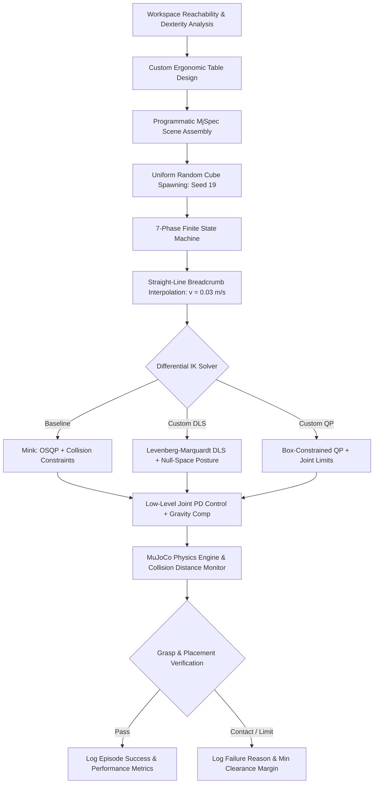
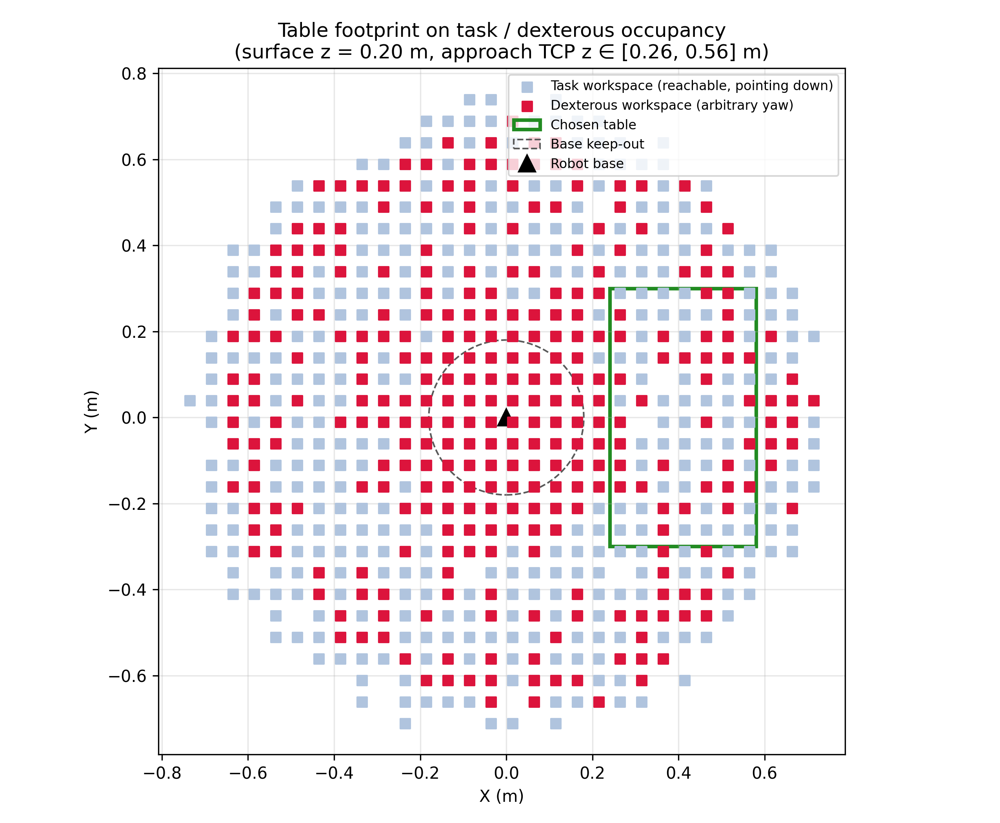
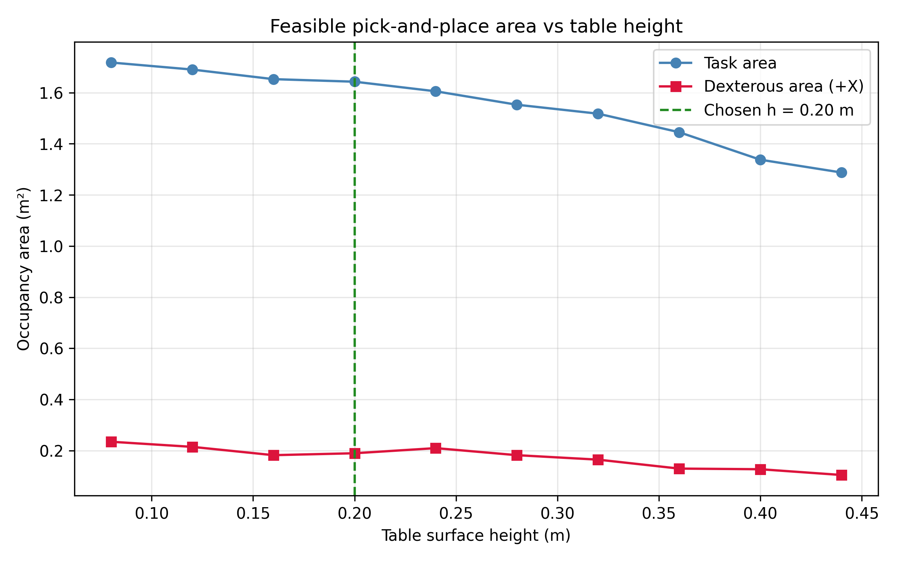
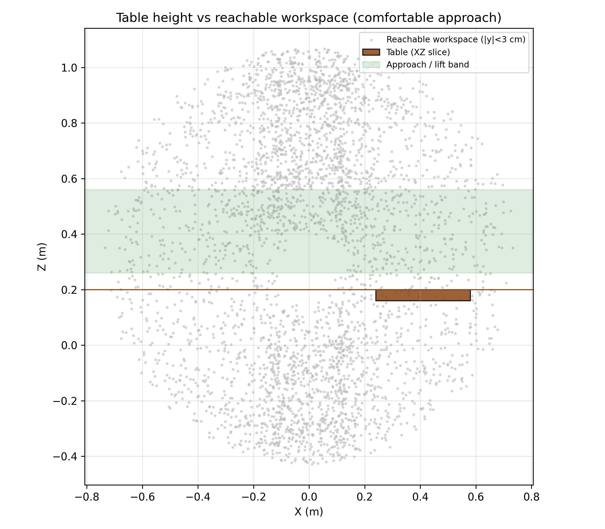
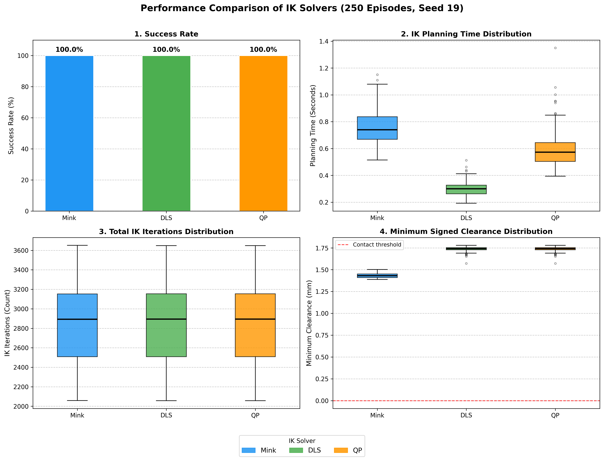
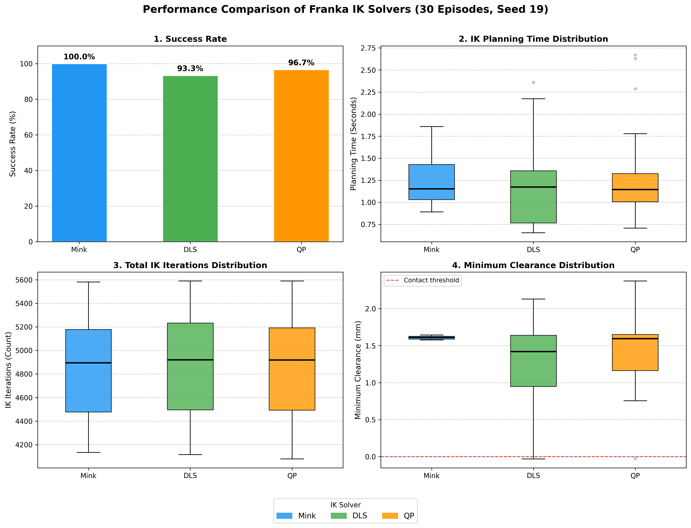

# Lab 03 — Autonomous Pick-and-Place Manipulation with HEAL & Franka Emika Panda

A physics-accurate pick-and-place manipulation pipeline implemented in [MuJoCo](https://mujoco.org/), benchmarking **Differential Inverse Kinematics (IK)** solvers across both a 6-DOF industrial arm and a 7-DOF redundant collaborative arm equipped with a Robotiq 2F-85 parallel-jaw gripper.

📄 **Full Technical Report:** [Tutorial_4___itr.pdf](Tutorial_4___itr.pdf)

---

## Video Demonstrations

All experiments and failure diagnostics are recorded and viewable on YouTube:

| Robotic Platform | Solver / Scenario | Demonstration Link | Core Observation |
|---|---|:---:|---|
| **6-DOF Addverb HEAL** | **Mink Differential IK** | [Watch Video (Mink)](https://youtu.be/h-dL-vL3UDM?si=1semsxsM4L094ZeF) | Smooth baseline differential IK trajectory with quadratic task cost and collision limits. |
| **6-DOF Addverb HEAL** | **Custom Damped Least Squares (DLS)** | [Watch Video (DLS)](https://youtu.be/FMAL-rnbg08?si=yBDw17tpFTI-orKf) | High-speed analytical Levenberg–Marquardt tracking achieving **2.5× faster** planning time. |
| **6-DOF Addverb HEAL** | **Custom Quadratic Programming (QP)** | [Watch Video (QP)](https://youtu.be/oaHxvoVMIUw?si=IdQEXkaOgRmZANhr) | Box-constrained optimization strictly enforcing joint limits and velocity bounds. |
| **7-DOF Franka Panda** | **Custom DLS Failure Analysis** | [Watch Video (Franka DLS Failure)](https://youtu.be/ERtZ837I5WE) | Diagnostic demonstration of redundant null-space elbow swivel causing tray wall grazing during `RELEASE`. |

---

## Table of Contents

1. [Overview & System Architecture](#overview--system-architecture)
2. [Workspace Analysis & Table Design](#workspace-analysis--table-design)
3. [Environment Modeling & Programmatic Assembly](#environment-modeling--programmatic-assembly)
4. [7-Phase Pick-and-Place State Machine](#7-phase-pick-and-place-state-machine)
5. [Trajectory Planning & Differential IK Formulations](#trajectory-planning--differential-ik-formulations)
   - [Trajectory Conditioning & Clamping](#trajectory-conditioning--error-clamping)
   - [1. Off-the-Shelf Differential IK (Mink)](#1-off-the-shelf-differential-ik-mink)
   - [2. Closed-Loop Damped Least Squares (DLS)](#2-closed-loop-damped-least-squares-dls)
   - [3. Constrained Quadratic Programming (QP)](#3-constrained-quadratic-programming-qp)
6. [Experimental Results & Benchmarking](#experimental-results--benchmarking)
   - [HEAL 6-DOF Benchmark (250 Episodes, Seed 19)](#heal-6-dof-benchmark-250-episodes-seed-19)
   - [Franka Emika Panda 7-DOF Benchmark (30 Episodes, Seed 19)](#franka-emika-panda-7-dof-benchmark-30-episodes-seed-19)
7. [Failure Mode & Collision Analysis](#failure-mode--collision-analysis)
   - [Robotiq Follower Linkage Table Scraping (Resolved)](#1-robotiq-follower-linkage-table-scraping-resolved)
   - [Franka Redundant Null-Space Tray Wall Grazing (YouTube Demo)](#2-franka-redundant-null-space-tray-wall-grazing-youtube-demo)
   - [Implemented Engineering Safeguards](#3-implemented-engineering-safeguards)
8. [Quickstart & Execution Guide](#quickstart--execution-guide)
9. [Codebase Architecture & File Inventory](#codebase-architecture--file-inventory)

---

## Overview & System Architecture

This project implements an end-to-end autonomous manipulation pipeline solving randomized pick-and-place tasks:
- **Robots Evaluated:**
  - **Addverb HEAL 6-DOF Arm:** Industrial non-redundant serial manipulator ($J(q) \in \mathbb{R}^{6 \times 6}$) where joint velocities are locally unique away from singularities (`single_arm_heal_effort_actuation_rs_mj.xml`).
  - **Franka Emika Panda 7-DOF Arm:** Kinematically redundant arm ($J(q) \in \mathbb{R}^{6 \times 7}$) with a 1-dimensional null space requiring active posture stabilization (`panda_nohand.xml`).
- **End-Effector:** Robotiq 2F-85 adaptive parallel-jaw gripper programmatically mounted at the arm flange using MuJoCo's `MjSpec` API.
- **Solvers Benchmarked:** Mink (OSQP baseline), Closed-Loop Damped Least Squares (DLS), and Box-Constrained Quadratic Programming (QP).
- **Control & Safety:** Joint PD torque control with gravity compensation feedforward (`qfrc_bias`), continuous signed clearance monitoring (`mj_geomDistance`), and bilateral grasp force verification.



---

## Workspace Analysis & Table Design

Standard tables (such as the default 1.2 m × 1.2 m, 0.80 m robosuite table) severely constrain manipulators by placing targets near reachability boundaries and causing collisions with the robot base turret. 

Reachable task workspace (gripper pointing downward) and dexterous workspace (arbitrary yaw rotation) were computed via Monte Carlo discretization in `scripts/workspace_task.py` and `table_design.py`.



### Quantitative Table Specifications

| Parameter | Optimized Value | Engineering Rationale |
|---|---|---|
| **Surface Height** | **0.20 m** | Downward TCP grasps sit near **$z = 0.36\text{ m}$**, directly inside the maximum manipulability core of `heal_workspace_xz.png`. |
| **Footprint ($X \times Y$)** | **0.34 m × 0.60 m** | Fitted strictly to dexterous cells in front of the base ($x \in [0.24, 0.58]$, $y \in [-0.30, 0.30]$), with a 3 cm safety inset from the reachability rim. |
| **Table Center Placement** | **$(0.41, 0.00)\text{ m}$** | Located in the $+X$ primary task sector with a 0.18 m keep-out radius around the base to prevent turret collision. |
| **Top Thickness** | **0.04 m** | Lightweight surface with support legs extending to the floor ($z = 0.00\text{ m}$). |




### Approach & Clearance Envelope
- The Robotiq 2F-85 gripper measures approximately **0.16 m** from mounting flange to fingertip pad center. With the table surface at $0.20\text{ m}$, a top-down grasp places the end-effector site at $z \approx 0.36\text{ m}$.
- The vertical transit band **$z \in [0.26, 0.56]\text{ m}$** lies well within the high-dexterity sphere (maximum arm reach $z \approx 1.07\text{ m}$, manipulability degrades significantly above $z \approx 0.80\text{ m}$).
- Lower tables ($0.08 - 0.12\text{ m}$) squeeze the gripper linkage against the surface during pre-grasp. Higher tables ($0.36 - 0.44\text{ m}$) dramatically shrink the dexterous area and push grasps toward kinematic singularity limits.

To regenerate table metrics and the XML definition:
```bash
cd lab/lab-03
source ../../venv/bin/activate
python3 table_design.py
```

---

## Environment Modeling & Programmatic Assembly

The simulation scene is assembled programmatically at runtime using MuJoCo's modern `MjSpec` API (`scripts/env_pick_place.py` for HEAL and `scripts_franka/env_pick_place.py` for Franka).

| Component | Model & Parameters | Role & Mechanics |
|---|---|---|
| **Robot Manipulator** | 6-DOF HEAL (`single_arm_heal_effort_actuation_rs_mj.xml`) or 7-DOF Franka Panda (`panda_nohand.xml`) | Torque-actuated revolute joints controlled via low-level joint PD loops with gravity compensation feedforward (`qfrc_bias`). |
| **End-Effector** | Robotiq 2F-85 Gripper | Programmatically attached to the arm's terminal site (`right_center` for HEAL, `attachment_site` for Franka) via `MjSpec.attach()`. |
| **Worksurface** | Optimized custom table (0.34 m × 0.60 m × 0.04 m at $z = 0.20\text{ m}$) | Serves as the stable support plane for pick-and-place operations. |
| **Target Object** | 5 cm cubic block ($0.05\text{ m}$, 80 g, freejoint, red) | Spawned at a uniformly sampled position on the $+Y$ half of the table: $x \in [0.30, 0.50]$, $y \in [0.06, 0.22]$, with randomized initial yaw $\psi \in [-\pi, \pi]$. |
| **Receptacle Tray** | 12 cm × 12 cm green tray with 1.5 cm raised perimeter walls | Centered on the $-Y$ table sector at $(0.41, -0.12)\text{ m}$. Raised walls prevent the placed block from sliding off. |

---

## 7-Phase Pick-and-Place State Machine

The task supervisor executes a deterministic 7-phase finite state machine:

```
  [APPROACH] ──> [DESCEND] ──> [GRASP] ──> [LIFT] ──> [TRANSIT] ──> [LOWER] ──> [RELEASE] ──> [DONE]
```

1. **`APPROACH` (Pre-Grasp Waypoint):**
   - End-effector aligns directly above the randomized cube position at $z_{approach} = z_{table} + 0.12\text{ m} + \Delta z_{ee}$.
   - End-effector orientation is aligned with the top-down normal vector combined with the nearest cube grasp yaw $\psi_{grasp}$.
2. **`DESCEND` (Vertical Grasp Alignment):**
   - Gripper descends vertically along the Z-axis to the calibrated grasp height ($z_{grasp} = z_{table} + 0.035\text{ m} + \Delta z_{ee}$).
3. **`GRASP` (Fingertip Closure):**
   - Gripper actuator closes the 2F-85 fingers while holding arm posture steady, verifying grasp security via bilateral pad contact forces ($F_L, F_R \ge F_{min} = 0.5\text{ N}$).
4. **`LIFT` (Vertical Object Retraction):**
   - Arm ascends vertically to $z_{lift} = z_{table} + 0.15\text{ m} + \Delta z_{ee}$, verifying vertical pickup displacement without tipping or slippage.
5. **`TRANSIT` (Horizontal Tray Transfer):**
   - End-effector transfers the grasped block laterally across the workspace to a target waypoint positioned directly above the receptacle tray at $(0.41, -0.12, z_{lift})$.
6. **`LOWER` (Receptacle Placement):**
   - Arm lowers the block into the receptacle tray just above the tray floor ($z_{place} = z_{table} + 0.035\text{ m} + \Delta z_{ee}$).
7. **`RELEASE` (Detachment & Upward Retreat):**
   - Gripper opens fully, retreats vertically, and verifies strict placement criteria: cube inside tray footprint, resting on the floor at $z \approx 0.229\text{ m}$, upright, at rest, and detached.

---

## Trajectory Planning & Differential IK Formulations

### Trajectory Conditioning & Error Clamping

Directly commanding large Cartesian displacements causes erratic, high-velocity joint swings. To enforce smooth, predictable trajectories:
1. **Straight-Line Breadcrumb Interpolation:**
   Trajectories are discretized into intermediate waypoints at constant Cartesian velocity $v_{move} = 0.03\text{ m/s}$:
   $$T_{move} = \max\left(\frac{D}{v_{move}}, \, T_{min}\right), \quad N_{steps} = \max\left(1, \, \left\lfloor\frac{T_{move}}{\Delta t_{IK}}\right\rfloor\right)$$
   $$p_d(\alpha_i) = p_{start} + \alpha_i (p_{target} - p_{start}), \quad q_d(\alpha_i) = \text{SLERP}(q_{start}, q_{target}, \alpha_i)$$
   where $\alpha_i = i / N_{steps}$ and $\Delta t_{IK} = 0.01\text{ s}$.
2. **Task-Space Error Clamping:**
   The 6D task-space error $e = [\Delta p^T, \Delta \theta^T]^T \in \mathbb{R}^6$ is clamped to $e_{max} = 0.02\text{ m/rad}$ before computing desired velocity:
   $$\bar{e} = e \cdot \min\left(1, \, \frac{e_{max}}{\|e\|_2}\right), \quad \dot{x}_d = \frac{\bar{e}}{\Delta t_{IK}}$$

---

### 1. Off-the-Shelf Differential IK (Mink)
[Mink](https://github.com/kevinzakka/mink) formulates differential IK as a configuration-space quadratic optimization problem:
$$\min_{\Delta q} \frac{1}{2} \| J(q) \Delta q - e_x \|_W^2 + \frac{1}{2} \| \Delta q \|_{R}^2$$
$$\text{subject to } \Delta q_{min} \le \Delta q \le \Delta q_{max}, \quad C \Delta q \le d$$
- Incorporates end-effector frame tracking, posture regularization, and `mink.CollisionAvoidanceLimit` linear distance inequalities.
- Solved at each control step via OSQP.

---

### 2. Closed-Loop Damped Least Squares (DLS)
Near kinematic singularities where $J$ loses rank, standard pseudo-inversion explodes. The Levenberg–Marquardt formulation simultaneously minimizes task tracking error and penalizes excessive joint velocities:
$$\mathcal{J}(\dot{q}) = \|J\dot{q} - \dot{x}_d\|_2^2 + \lambda \|\dot{q}\|_2^2$$
Expanding and setting the gradient to zero yields the analytical closed-form solution:
$$\dot{q}_{task} = \left( J^T J + \lambda I_n \right)^{-1} J^T \dot{x}_d = J_{DLS}^\dagger \dot{x}_d$$
where $\lambda = d^2$ with $d = 10^{-2}$.

#### Redundancy Resolution (7-DOF Franka Panda)
For the 7-DOF arm, an explicit null-space projector drives the redundant elbow toward a safe resting posture $q_{def}$ without perturbing end-effector tracking:
$$\dot{q} = \dot{q}_{task} + \left( I_n - J_{DLS}^\dagger J \right) k_{null} (q_{def} - q)$$
where $k_{null} = 0.5\text{ s}^{-1}$ and velocities are saturated to physical limits $[-2.0, 2.0]\text{ rad/s}$.

---

### 3. Constrained Quadratic Programming (QP)
While DLS applies velocity bounds by post-hoc clipping, the QP formulation natively embeds physical joint position and velocity limits directly into the optimization:
$$\min_{\dot{q}} \frac{1}{2} \dot{q}^T P \dot{q} + c^T \dot{q} \quad \text{subject to } l \le \dot{q} \le u$$
where:
$$P = J^T J + \lambda I_n, \quad c = -J^T \dot{x}_d$$
Adding $\lambda I_n$ ensures $P$ remains strictly positive definite and convex for redundant manipulators.

The lower and upper velocity bounds for joint $k \in \{1, \dots, n\}$ enforce both speed saturation ($\dot{q}_{max} = 2.0\text{ rad/s}$) and mechanical joint limits $[q_{k,min}, q_{k,max}]$:
$$l_k = \max\left(-\dot{q}_{max}, \, \frac{q_{k,min} - q_k}{\Delta t_{IK}}\right), \quad u_k = \min\left(\dot{q}_{max}, \, \frac{q_{k,max} - q_k}{\Delta t_{IK}}\right)$$

---

## Experimental Results & Benchmarking

Benchmarks were evaluated on both manipulators using a shared random seed (`--seed 19`) across identical spawn distributions.

### HEAL 6-DOF Benchmark (250 Episodes, Seed 19)

All three solvers achieved a **100.0% success rate** across 250 randomized pick-and-place episodes.

| IK Solver | Episodes ($N$) | Success Rate (%) | Mean Planning Time (s / episode) | Mean Wall Time (s / episode) | Total IK Iters (Cumulative / Mean) | Min Clearance (mm) |
|---|:---:|:---:|:---:|:---:|:---:|:---:|
| **Mink (Baseline)** | 250 | **100.0%** (250/250) | 0.7526 | 9.1484 | 713,155 (2852.6) | 1.388 |
| **Custom DLS** | 250 | **100.0%** (250/250) | **0.2991** (⚡ 2.5× faster) | **8.5118** | 713,306 (2853.2) | **1.573** |
| **Custom QP (daqp)** | 250 | **100.0%** (250/250) | 0.5851 (⚡ 1.3× faster) | 9.1510 | 713,302 (2853.2) | **1.573** |



#### Key Observations (HEAL 6-DOF):
1. **Planning Speed:** Custom DLS is the fastest solver (0.2991 s/episode), running **2.5× faster** than Mink and **1.9× faster** than Custom QP due to direct analytical pseudoinverse computation.
2. **Iteration Consistency:** All solvers converged in nearly identical iteration counts (~2,853 steps), validating that fixed-velocity breadcrumb interpolation produces identical waypoint trajectories.
3. **Clearance:** All solvers maintained positive minimum clearances (> 1.38 mm), avoiding furniture contact.

---

### Franka Emika Panda 7-DOF Benchmark (30 Episodes, Seed 19)

The redundant 7-DOF kinematic chain with physical joint limits differentiates solver performance.

| IK Solver | Episodes ($N$) | Success Rate (%) | Mean Planning Time (s / episode) | Mean Wall Time (s / episode) | Total IK Iters (Cumulative / Mean) | Min Clearance (mm) |
|---|:---:|:---:|:---:|:---:|:---:|:---:|
| **Mink (Baseline)** | 30 | **100.0%** (30/30) | 1.229 | **206.59** | 145,631 (4854.4) | **+1.580** |
| **Custom DLS** | 30 | 93.33% (28/30) | **1.166** | 272.77 | 143,745 (4791.5) | -0.031 (grazing) |
| **Custom QP (daqp)** | 30 | 96.67% (29/30) | 1.275 | 246.17 | 144,644 (4821.5) | -0.025 (grazing) |



---

## Failure Mode & Collision Analysis

### 1. Robotiq Follower Linkage Table Scraping (Resolved)

In initial 6-DOF HEAL tests, batch runs reported **0/25 successes**, with collision logs consistently indicating contact between `geom71` (Robotiq follower linkage) and the table top surface.

```
Initial Grasp Alignment:
  z_grasp = z_table + 0.025 m (exact cube center)
  Follower Linkage Travel: Kinematic four-bar linkage extends 8 mm below pad plane during closing stroke.
  Result: Follower linkage scrapes the table (-0.42 mm penetration) before grasp completes.
```

**Resolution:**
The grasp elevation was calibrated by introducing a $+1.0\text{ cm}$ offset above cube center:
$$z_{grasp} = z_{table} + 0.035\text{ m} + \Delta z_{ee}$$
This ensures the follower linkage remains elevated above the table plane throughout its closing arc while maintaining $>80\%$ pad contact area with the 5 cm cube faces. Success rate immediately jumped from 0% to 100%.

---

### 2. Franka Redundant Null-Space Tray Wall Grazing (YouTube Demo)

🎥 **Demonstration Video:** [Franka DLS Failure Mode on YouTube](https://youtu.be/ERtZ837I5WE)

In the 30-episode Franka benchmark, **three episodes failed**: two in Custom DLS (Episodes 5 & 6) and one in Custom QP (Episode 12).

| Method | Episode File | Cube Start $(x, y, z)$ (m) | Cube End $(x, y, z)$ (m) | Min Clearance | Plan / Wall Time | Total IK Iters |
|---|---|:---:|:---:|:---:|:---:|:---:|
| **Custom DLS** | `episode_005.json` | $(0.481, 0.139, 0.230)$ | $(0.406, -0.122, 0.229)$ | **-0.0306 mm** | 0.895 s / 186.3 s | 3,654 |
| **Custom DLS** | `episode_006.json` | $(0.493, 0.058, 0.230)$ | $(0.404, -0.121, 0.229)$ | **-0.0127 mm** | 0.792 s / 163.8 s | 3,211 |
| **Custom QP** | `episode_012.json` | $(0.420, 0.153, 0.230)$ | $(0.407, -0.122, 0.229)$ | **-0.0249 mm** | 0.827 s / 156.6 s | 3,835 |

#### Diagnostic Findings:
1. **Task Success vs. Strict Collision Flagging:** In all three failed runs, the manipulation task physically succeeded—the cube was placed cleanly inside the tray, upright, at rest, and released. However, the safety monitor flagged a micro-penetration ($-12.7\,\mu\text{m}$ to $-30.6\,\mu\text{m}$).
2. **Mechanism of Contact:** The solver exited `PLACE` upon reaching within $5\text{ mm}$ position tolerance (`POS_TOL = 0.005 m`), leaving the cube slightly shifted toward the $-X$ tray wall ($x \approx 0.404 - 0.406\text{ m}$). Upon opening fingers during `RELEASE`, the outer pad linkage (`geom73`) lightly brushed against the $15\text{ mm}$ wall (`tray_wall_mx`).
3. **Why Mink Avoided This:** Mink directly incorporates obstacle distance inequality constraints into its optimization, preventing secondary null-space reconfiguration from encroaching on the tray wall boundary.

---

### 3. Implemented Engineering Safeguards

1. **Tightening Placement Tolerance:** Lowering `POS_TOL` from 5 mm to 2 mm centers the gripper strictly over the tray midpoint ($x = 0.410\text{ m}$).
2. **Yaw Alignment Reset:** Resetting target orientation to $0^\circ$ yaw during `TRANSIT` ensures the opening fingers remain parallel to tray boundaries.
3. **Step Error Clamping ($e_{max} = 0.02$):** Eliminates velocity spikes that cause joint oscillations near table boundaries.
4. **Valid Keyframe Initialization:** Loading the official home keyframe (`model.key_qpos[0, :7]`) prevents Franka Joint 4 ($0.0\text{ rad}$) from starting outside its physical range ($[-3.07, -0.07]\text{ rad}$).
5. **Softened Null-Space Gain ($k_{null} = 0.5$):** Prevents the secondary posture task from overpowering primary Cartesian trajectory tracking.

---

## Quickstart & Execution Guide

### Environment Setup
Activate the virtual environment containing MuJoCo, Mink, and NumPy:
```bash
cd lab/lab-03
source ../../venv/bin/activate
```

### 1. Interactive 3D Simulation (GUI)
Run a single interactive pick-and-place episode with live rendering:

```bash
# HEAL 6-DOF Manipulator:
python3 scripts/ik_pick_place.py          # Mink
python3 scripts/ik_dls_pick_place.py      # Custom DLS
python3 scripts/ik_qp_pick_place.py       # Custom QP

# Franka 7-DOF Panda Manipulator:
python3 scripts_franka/ik_pick_place.py      # Mink
python3 scripts_franka/ik_dls_pick_place.py  # Custom DLS
python3 scripts_franka/ik_qp_pick_place.py   # Custom QP
```

### 2. Headless Batch Benchmarks
Run multi-episode headless benchmarks with deterministic seed reproduction (`--seed 19`):

```bash
# HEAL 6-DOF (25 episodes):
python3 scripts/ik_pick_place.py --episodes 25 --seed 19 --no-gui
python3 scripts/ik_dls_pick_place.py --episodes 25 --seed 19 --no-gui
python3 scripts/ik_qp_pick_place.py --episodes 25 --seed 19 --no-gui

# Franka 7-DOF Panda (30 episodes):
python3 scripts_franka/ik_pick_place.py --episodes 30 --seed 19 --no-gui
python3 scripts_franka/ik_dls_pick_place.py --episodes 30 --seed 19 --no-gui
python3 scripts_franka/ik_qp_pick_place.py --episodes 30 --seed 19 --no-gui
```

### 3. Generate Benchmark Comparison Plots
Generate publication-quality 2×2 multi-panel comparison figures (300 DPI):

```bash
# HEAL 6-DOF figure (logs/ik_comparison_plots_seed19.png):
python3 scripts/plot_results.py

# Franka 7-DOF figure (logs/ik_franka_comparison_plots_seed19.png):
python3 scripts_franka/plot_results_frank.py
```

---

## Codebase Architecture & File Inventory

```
lab/lab-03/
├── README.md                                # Comprehensive laboratory documentation
├── Tutorial_4___itr.pdf                     # Formal research paper / technical lab report
├── table_design.py                          # Workspace analysis & table geometry optimization
├── table_design.json                        # Output table parameters & placement coordinates
├── heal_pick_place.xml                      # Generated MuJoCo XML scene for HEAL arm
├── table_design_occupancy.png               # 2D workspace reachability & dexterity heatmaps
├── table_design_height.png                  # Z-slice reachability analysis
├── table_design_xz.png                      # Sagittal reachability cross-section
├── scripts/                                 # 6-DOF HEAL arm implementation
│   ├── env_pick_place.py                    # Programmatic MjSpec scene builder for HEAL
│   ├── ik_pick_place.py                     # Mink differential IK solver & state machine
│   ├── ik_custom_core.py                    # Shared kinematics, Jacobian, and step evaluation
│   ├── ik_dls_pick_place.py                 # Closed-loop Damped Least Squares runner
│   ├── ik_qp_pick_place.py                  # Box-constrained Quadratic Programming runner
│   ├── plot_results.py                      # 2×2 multi-panel benchmarking script for HEAL
│   └── run_episodes.py                      # Multi-episode randomized data collection
├── scripts_franka/                          # 7-DOF Franka Panda implementation
│   ├── env_pick_place.py                    # Programmatic MjSpec scene builder for Franka
│   ├── ik_pick_place.py                     # Mink differential IK solver for Franka
│   ├── ik_custom_core.py                    # 7-DOF Jacobian mapping & velocity packing
│   ├── ik_dls_pick_place.py                 # 7-DOF DLS with null-space posture projection
│   ├── ik_qp_pick_place.py                  # 7-DOF QP with regularized positive-definite Hessian
│   └── plot_results_frank.py                # 2×2 multi-panel benchmarking script for Franka
└── logs/                                    # Benchmark logs, episode JSONs, and comparison figures
    ├── ik_comparison_plots_seed19.png       # HEAL 250-episode benchmark figure
    └── ik_franka_comparison_plots_seed19.png# Franka 30-episode benchmark figure
```

---

## Conclusion

1. **Speed vs. Constraint Handling:** In unconstrained workspaces (6-DOF HEAL), all solvers achieve 100.0% reliability, with **Custom DLS** offering the highest computational speed (0.299 s). In constrained redundant settings (7-DOF Franka), **Mink** delivers superior reliability (100.0%) and execution smoothness by explicitly enforcing collision inequalities.
2. **Trajectory Conditioning:** Straight-line breadcrumb interpolation ($v_{move} = 0.03\text{ m/s}$), step error clamping ($e_{max} = 0.02$), and gentle null-space damping ($k_{null} = 0.5$) are essential prerequisites for stable differential IK execution.
3. **Physical Clearance Calibration:** Multi-bar linkage grippers require intentional vertical offsets ($+1\text{ cm}$) to accommodate closing arcs without ground scraping.
