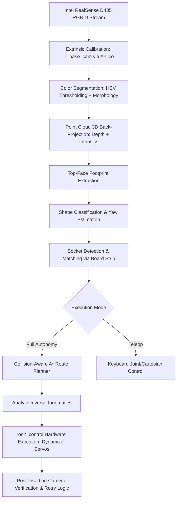

# ME-639 Course Capstone Projects — The Tri-Wizard Tournament

This directory contains the final autonomous robotics projects for **ME-639: Introduction to Robotics** at IIT Gandhinagar. The tournament consists of two advanced manipulation challenges executed on physical industrial and collaborative hardware:

1. **Tri-Wizard Task 1 — Autonomous Peg Sorting (ROBOTIS OpenMANIPULATOR-X + RealSense RGB-D)**
   - Standalone Refined Repository: [`RishabhShahIITGN/peg-sorting-OMX`](https://github.com/RishabhShahIITGN/peg-sorting-OMX)
   - 🎥 **Video Demonstration:** [Watch on YouTube](https://youtu.be/XiwHk8Va8t8)
2. **Tri-Wizard Task 2 — The Buzz Wire Trace Challenge (Addverb HEAL 6-DOF Cobot)**
   - Standalone Repository: [`RishabhShahIITGN/The-Wire-Trace-Trial-Heal`](https://github.com/RishabhShahIITGN/The-Wire-Trace-Trial-Heal)
   - 🎥 **Video Demonstrations:**
     - **Forward Run:** [Watch on YouTube](https://youtu.be/hoY5CwrO2DI)
     - **Backward Run:** [Watch on YouTube](https://youtu.be/m1hTtmguCew)

---

## Table of Contents

- [Task 1: Autonomous Peg Sorting](#task-1-autonomous-peg-sorting-openmanipulator-x)
  - [System Architecture & Pipeline](#system-architecture--pipeline)
  - [Hardware & Software Stack](#hardware--software-stack)
  - [Physical Setup & Layout](#physical-setup--layout)
  - [Computer Vision & Calibration](#computer-vision--calibration)
  - [Motion Planning & Collision Avoidance](#motion-planning--collision-avoidance)
  - [Running the System (Teleop & Autonomy)](#running-the-system-teleop--autonomy)
  - [Safety & Emergency Stop](#safety--emergency-stop)
- [Task 2: Buzz Wire Trace Challenge](#task-2-buzz-wire-trace-challenge-addverb-heal)
  - [Overview & Methodology](#overview--methodology)
  - [Trajectory Processing & DLS-IK Replay](#trajectory-processing--dls-ik-replay)
  - [Experimental Results](#experimental-results)
- [Directory Layout & Workspace Navigation](#directory-layout--workspace-navigation)

---

## Task 1: Autonomous Peg Sorting (OpenMANIPULATOR-X)

A human participant places one colored peg at an arbitrary upright position in the robot workspace. The autonomous system segments the peg from live RGB-D imagery, identifies its geometric shape and orientation, pairs it with the matching receptacle socket on the board, plans a collision-free 3D trajectory around previously placed pegs, and executes a precision pick-and-place insertion.

🎥 **Demonstration Video:** [Watch on YouTube](https://youtu.be/XiwHk8Va8t8)  
📄 **Quick Operator Checklist:** [`RUN_STEPS.md`](RUN_STEPS.md)

### Peg Specifications

| Peg | Nominal Color | Cross-Section Geometry | Height |
|---|---|---|---|
| **Square** | Blue | $0.040\text{ m} \times 0.040\text{ m}$ | $98\text{ mm}$ |
| **Triangle** | Yellow | Equilateral, $0.034\text{ m}$ sides | $98\text{ mm}$ |
| **Hexagon** | Orange | Regular hexagon, $0.020\text{ m}$ sides | $98\text{ mm}$ |
| **Circle** | Green | $\varnothing\,0.040\text{ m}$ cylinder | $98\text{ mm}$ |

---

### System Architecture & Pipeline



---

### Hardware & Software Stack

| Component | Specification | Notes |
|---|---|---|
| **Manipulator** | ROBOTIS OpenMANIPULATOR-X | 4-DOF articulated arm + 1-DOF parallel gripper (Dynamixel XM430-W350-T actuators) |
| **Interface** | ROBOTIS U2D2 USB-to-RS485 adapter | Port `/dev/ttyUSB0` with $1\text{ ms}$ latency timer |
| **Vision Sensor** | 1× Intel RealSense D435 / D435i | Serial `_332322071822`, RGB ($640 \times 480$) + aligned depth ($30\text{ Hz}$) |
| **Operating System** | Ubuntu 22.04 LTS (native) | ROS 2 Humble Hawksbill |
| **Control Framework** | `ros2_control` + `dynamixel_hardware_interface` | Joint trajectory controller + gripper action server |
| **Vision Libraries** | OpenCV 4.5.4 (`python3-opencv`), `cv_bridge`, `cv2.aruco` | Custom morphology and polygon approximation |

#### Critical USB Latency Configuration
With the default $16\text{ ms}$ FTDI latency timer, Dynamixel packet reads frequently fail with `FastSyncRead Rx Fail -3001`. Set the latency timer to $1\text{ ms}$:
```bash
echo 'ACTION=="add", SUBSYSTEM=="usb-serial", DRIVER=="ftdi_sio", ATTR{latency_timer}="1"' \
  | sudo tee /etc/udev/rules.d/99-dynamixel.rules
sudo udevadm control --reload-rules && sudo udevadm trigger
```

---

### Physical Setup & Layout

- **Robot Base:** Bolted to the table plane ($z = 0.00\text{ m}$).
- **Board Strip:** Placed flat on the table, $17 - 19\text{ cm}$ from the robot base. Sockets must lie within $20.5\text{ cm}$ radius (`vision.max_socket_radius_m`).
- **Peg Ingestion Ring:** Pegs are placed upright in the workspace between $11\text{ cm}$ and $18\text{ cm}$ from the base, clear of the board.
- **Camera Mount:** Fixed overhead at $\sim 42\text{ cm}$ height with $\sim 31^\circ$ downward tilt, providing a full field of view over the peg spawning zone and socket board.

---

### Computer Vision & Calibration

#### 1. Extrinsic Calibration (`scripts/calibrate_extrinsics.py`)
Relates camera coordinates to the robot base frame (`link1`, $+X$ forward, $+Y$ left, $+Z$ up) using a known ArUco marker (`DICT_4X4_50`, ID 0):
```bash
cd project/peg_ws/src/tri-wizard-peg-trial
# Save test frames from live camera
python3 scripts/save_frames.py
# Calibrate extrinsics (place marker at measured table coordinates, e.g. x=0.20, y=0.00, z=0.0)
python3 scripts/calibrate_extrinsics.py --camera cam1 --size 0.08 --x 0.20 --y 0.00 --z 0.0
```
Extrinsics are stored as $T_{\text{base}}^{\text{cam}}$ in `config/camera_calib.yaml`.

#### 2. HSV Color Segmentation
Tuned for demo lighting conditions (`config/colors.yaml`):

| Target Shape | Peg Color | Lower Bound $[H, S, V]$ | Upper Bound $[H, S, V]$ |
|---|---|---|---|
| **Hexagon** | Orange | $[4, 150, 90]$ | $[16, 255, 255]$ |
| **Triangle** | Yellow | $[23, 175, 150]$ | $[32, 255, 255]$ |
| **Circle** | Green | $[31, 100, 40]$ | $[85, 255, 255]$ |
| **Square** | Blue | $[95, 100, 50]$ | $[130, 255, 255]$ |
| **Board Strip** | MDF Brown | $[10, 20, 50]$ | $[30, 180, 240]$ |

---

### Motion Planning & Collision Avoidance

1. **4-DOF Orientation Constraint:** Because the OpenMANIPULATOR-X lacks a wrist roll joint, the gripper fingers always close perpendicular to the radial vector from the base. When grasping polygonal pegs, the fingers rotate the peg until a flat face aligns with a finger pad. Per-shape socket placement offsets in `config/task.yaml` compensate for this geometric coupling.
2. **Obstacle Modeling:** Placed pegs are dynamically added to the obstacle collision map as bounding cylinders. The planner routes the carried peg either **over** placed pegs (if reach allows) or **around** them via Cartesian waypoints.
3. **Calibrated Waypoint Heights:**
   - **Grasp Depth:** Gripper center $4\text{ mm}$ below peg top ($z \ge 78\text{ mm}$ from base).
   - **Transit / Carry Height:** $z = 113\text{ mm}$.
   - **Socket Hover Height:** $z = 110\text{ mm}$.
   - **Release Height:** $z = 105\text{ mm}$ ($5\text{ mm}$ downward insertion before finger opening).

---

### Running the System (Teleop & Autonomy)

Build the ROS 2 workspace from `project/peg_ws`:
```bash
cd project/peg_ws
colcon build --symlink-install
source install/setup.bash
```

#### Terminal 1 — Hardware Bringup:
```bash
ros2 launch open_manipulator_x_bringup hardware.launch.py
```

#### Terminal 2 — Camera Streaming:
```bash
ros2 launch peg_trial cameras.launch.py
```

#### Terminal 3 — Full Autonomous Run:
```bash
cd project/peg_ws/src/tri-wizard-peg-trial
./launch/run_autonomy.sh
```
*Note: Use `./launch/run_autonomy.sh dry_run` to test planning and vision without moving the physical arm.*

#### Interactive Keyboard Teleoperation:
```bash
cd project/peg_ws/src/tri-wizard-peg-trial
./launch/run_teleop.sh
```

| Key Group | Action |
|---|---|
| `w` / `s`, `a` / `d`, `r` / `f` | Cartesian jog: Forward/Back, Left/Right, Up/Down |
| `q` / `e`, `t` / `y`, `u` / `i`, `j` / `k` | Joint jog: Joints 1 through 4 |
| `o` / `c` | Open / Close gripper |
| `g` / `l` / `p` | Macro: Grasp / Lift / Place |
| `h` | Move to Home configuration |
| `1` – `4` | Hover over detected peg (Triangle, Square, Hexagon, Circle) |
| `6` – `9` | Hover over corresponding socket |
| `SPACE` | **Emergency Stop (Hold Position)** |

---

### Safety & Emergency Stop

- **Software E-Stop:** Press `SPACE` in the teleop terminal to publish `true` to `/peg_trial/estop`. The arm halts immediately. Press `x` to clear.
- **Hardware E-Stop:** Keep a hand on the $12\text{ V}$ power switch of the U2D2 power hub. Switching off power cuts actuator torque instantly.

---

## Task 2: Buzz Wire Trace Challenge (Addverb HEAL)

Standalone Project Repository: [`RishabhShahIITGN/The-Wire-Trace-Trial-Heal`](https://github.com/RishabhShahIITGN/The-Wire-Trace-Trial-Heal)

The second capstone trial requires an industrial 6-DOF **Addverb HEAL** collaborative arm to autonomously guide a conductive loop along a twisted 3D wire track without making physical contact (avoiding triggering the buzzer).

### Video Demonstrations
- 🎥 **Forward Run (Start to End):** [Watch on YouTube](https://youtu.be/hoY5CwrO2DI)
- 🎥 **Backward Run (End to Start):** [Watch on YouTube](https://youtu.be/m1hTtmguCew)

### Methodology & Pipeline
1. **Kinesthetic Path Teaching (`stage1/teleop_teach.py`):** The trajectory is taught via fine keyboard Cartesian jogging while recording the tool tip pose ($rq\_tool\_tip + 95\text{ mm}$ stick loop center).
2. **Trajectory Processing (`stage1/process_teach.py`):** Raw recorded waypoints are cleaned, smoothed using B-splines, and parameterized with velocity/acceleration bounds.
3. **Closed-Loop DLS-IK Replay (`stage1/replay_dls.py`):** The robot replays the trajectory using Damped Least Squares Inverse Kinematics, publishing 6 joint velocity commands to `/velocity_controller/commands`.
4. **Touch Event Monitoring (`stage1/evaluate_runs.py`):** Real-time touch events are marked when the circuit buzzer sounds, logging trajectory tracking error and clearance.

### Experimental Performance

| Run Log | Direction | Trajectory | Duration | Max Tip Error | Touches |
|---|---|---|---|---|:---:|
| `replay_20261117_223942.csv` | Forward | `traj_fast3` | $63.7\text{ s}$ | $4.65\text{ mm}$ | **0 (Clean)** |
| `replay_rev_20261117_223732.csv` | Backward | `traj_fast3` | $62.6\text{ s}$ | $4.48\text{ mm}$ | **0 (Clean)** |
| `replay_20261117_221541.csv` | Forward | `traj_fast` | $97.4\text{ s}$ | $3.37\text{ mm}$ | **0 (Clean)** |
| `replay_rev_20261117_221203.csv` | Backward (half-speed) | `traj_fast` | $190.6\text{ s}$ | $1.63\text{ mm}$ | **0 (Clean)** |

---

## Directory Layout & Workspace Navigation

```
project/
├── README.md                            # Comprehensive project overview & documentation
├── RUN_STEPS.md                         # Detailed step-by-step peg sorting operator manual
├── peg_ws/                              # Active ROS 2 Humble workspace
│   ├── build/                           # Colcon build output
│   ├── install/                         # Setup scripts & symlink install
│   ├── log/                             # Colcon compilation logs
│   └── src/
│       ├── open_manipulator/            # ROBOTIS OpenMANIPULATOR-X driver (ros2_control)
│       └── tri-wizard-peg-trial/        # Main Peg Sorting ROS 2 package
│           ├── config/                  # camera_calib.yaml, colors.yaml, task.yaml
│           ├── docs/                    # Architecture guides & diagrams
│           ├── launch/                  # cameras, vision, autonomy, teleop scripts
│           ├── peg_trial/               # Python nodes: vision, planning, control
│           ├── scripts/                 # Calibration, HSV tuning, workspace check
│           └── tests/                   # Pytest suite (38 unit tests)
├── peg_trial_task1/                     # Historical milestone checkpoint 1
└── peg_trial_collision (1)/             # Historical milestone checkpoint 2
```
